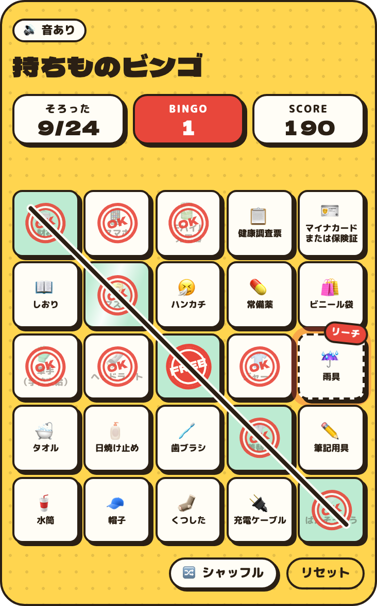

# 持ちものビンゴ（Packing Bingo）

**修学旅行の持ち物チェックを、音・振動・花火で楽しく進めるビンゴにするReactコンポーネントです。**

[](https://jin-hiroo.github.io/packing-bingo/)
[](https://www.npmjs.com/package/packing-bingo)
[](LICENSE)
[](#概要)
[](#api)
[](#単体のページ)

[デモサイト](https://jin-hiroo.github.io/packing-bingo/) · [v0.5.0 Release](https://github.com/Jin-hiroo/packing-bingo/releases/tag/v0.5.0) · [クイックスタート](#クイックスタート) · [デモコード](#デモ) · [使い方の例](#使い方の例) · [API](#api) · [組み込むときの注意](#組み込むときの注意) · [Reactなしで使う](#reactなしで使う) · [English](#english) · [変更履歴](CHANGELOG.md)

<p align="center">
  <a href="docs/images/bingo-desktop.png"></a>
</p>

_2コンボで2列目がそろったところ。列に線が引かれ、BINGO!と+100が出て、紙吹雪が舞います。_

<p>
  <a href="docs/images/phone-reach.png"></a>
  <a href="docs/images/phone-combo.png"></a>
  <a href="docs/images/phone-perfect.png"></a>
</p>

_0.5.0のスマホ幅での表示。左から、1列そろって次の列にリーチがかかったところ、3回続けたコンボ、全部そろったときのパーフェクト画面です。_

## できること

修学旅行の前の晩の荷造りは面倒です。持ちものビンゴは16個の持ち物をビンゴカードに並べるので、持ち物を1つ入れるたびにスタンプが押せて、何個かごとにお祝いがあります。

- **タップするたびに手応えがあります。** 押し込んで弾むスタンプ、波紋、火花、打撃音で反応します。2.5秒以内に続けてタップするとコンボになり、音と演出が強まります。Androidでは3・6・9コンボで振動のリズムも変わります。
- **次の目標がいつも見えます。** あと1つで列がそろうマスは、リーチの札を付けて点滅します。
- **ビンゴの数でお祝いが変わります。** タテ・ヨコ・ナナメの列（4×4なら10列）がそろうと、BINGO!の文字と紙吹雪が出ます。Androidではビンゴ・ダブル・トリプル以上で振動が変わり、全部そろうと約5秒、7発の花火・破裂音・振動がリズムを刻みます。結果画面は、アプリを切り替えて戻っても残ります。
- **マスの数を選べます。** 3×3や5×5など、2×2から10×10までの正方形にできます。奇数のときは、真ん中をはじめからスタンプ済みのFREEマスにできます。[マスの数を変える](#マスの数を変える)を見てください。
- **並びをシャッフルできます。** 🔀ボタンで、持ち物をランダムなマスに並べ替えます。チェックは持ち物といっしょに動くので、同じ持ち物で別の列をねらえます。並べ替えた並びも保存されます。
- **得点は、そろえることへのごほうびです。** 付けたり外したりしても増えません。[得点のルール](#得点のルール)を見てください。
- **進み具合は自動で保存されます。** 各自のブラウザ（localStorage）に保存されるので、ページを閉じても続きから始められます。サーバーには何も送りません。
- **音・振動・動きを選べます。** キーボードで操作でき、視覚のアニメーションは `prefers-reduced-motion`（動きを減らす設定）に従います。音はボタンで、振動は `vibrate={false}` で止められます。iPhoneの振動はタップ時の軽い触覚だけで、演出に合わせた振動はAndroid向けです（[音と振動](#音と振動)）。

## 概要

| 項目 | 内容 |
| --- | --- |
| インストール | `npm install packing-bingo`。ESMとCommonJSの両方、TypeScriptの型付き |
| 必要なもの | React 18以上と `react-dom`。ほかに依存するパッケージはありません。CSSの読み込みもProviderも不要です |
| サイズ | 約17 kB（ブラウザ版のminify・gzip後、CSS込み、Reactは含まず） |
| サーバー側での表示 | `"use client"` 付きで配布しています。サーバー側では空の `<div>` を出し、ブラウザでカードを作ります |
| 見た目 | `<head>` に `<style>` を1つ追加します。クラス名はすべて `pkb-` で始まります。CSS変数で配色を変えられ、置いた場所の幅に合わせて自動で大きさが変わります |
| 通信 | しません。見出しなどのフォントは、使うときにページで読み込みます（[フォント](#フォント)） |
| 保存 | localStorageだけ。進み具合、シャッフルした並び、音のオン・オフの設定 |
| ブラウザ | Chrome・Edge 105以上、Safari 16以上、Firefox 121以上。今のところChromiumでしか試していません（[詳しく](#対応ブラウザと確認済みの範囲)） |

## 0.5.0へアップデート

```sh
npm install packing-bingo@latest
```

0.5.0では、ビンゴ別の振動と花火に同期したフィナーレ、強くなったタップ反応、最初に音量とAndroidのおやすみモードを確認するポップアップを追加しました。全達成の結果画面は、タブやアプリを切り替えても消えません。ポップアップの文言や非表示設定は[音と振動](#音と振動)で変更できます。

0.3.xから更新する場合は、シャッフルと `vibrate` が追加され、フォントの自動読み込みがなくなった点にも注意してください。Google Fontsを使う場合は、クイックスタートの `<link>` をページに追加します。独自の完全な `Messages` オブジェクトには `shuffle` が必要です。詳しくは[変更履歴](CHANGELOG.md)を見てください。

## クイックスタート

コピーして貼り付けるだけで、サイトの好きな場所に置けます。進み具合は各自のブラウザに自動で保存されるので、保存の設定も要りません。

### 1. インストールする

```sh
npm install packing-bingo
```

pnpmなら `pnpm add packing-bingo`、yarnなら `yarn add packing-bingo` です。

### 2. 表示したい場所に置く

表示したいページやコンポーネントで読み込み、置きたい場所に `<PackingBingo />` と書きます。一般的な修学旅行の持ち物16個が、4×4のカードに並びます。

```tsx
import { PackingBingo } from "packing-bingo";

// JSXの中の、表示したい場所に
<PackingBingo />
```

Next.js（App Router）で専用のページを作るなら、`app/packing/page.tsx` を作って次を貼り付けます。`/packing` を開くと表示されます。

```tsx
import { PackingBingo } from "packing-bingo";

export default function PackingPage() {
  return (
    <main style={{ padding: 16 }}>
      <PackingBingo />
    </main>
  );
}
```

デモサイトと同じフォントにするなら、ページの `<head>` に次の1行を足します。Next.jsなら `app/layout.tsx` の `<html>` の中に `<head>` を書いてそこへ、Viteなら `index.html` の `<head>` へ入れます。足さなくても動き、そのときは端末のフォントで表示されます（[フォント](#フォント)）。

```html
<link rel="stylesheet" href="https://fonts.googleapis.com/css2?family=Dela+Gothic+One&family=M+PLUS+Rounded+1c:wght@500;800&display=swap" />
```

カードは置いた場所の幅いっぱい（最大720 px）に広がり、狭い場所ではスマホ向けの配置に自動で切り替わります。

Next.jsのServer Componentのページからでも、そのまま使えます。ただし、`onBingo` などの関数（コールバック）はServer Componentから渡せず、「Event handlers cannot be passed to Client Component props」というエラーでビルドが止まります。コールバックを使うときは、1行目に `"use client";` を書いたファイル（client component）の中に `<PackingBingo>` を置いてください。

### 3. 持ち物を変える

`items` に、持ち物を左上から横に1行ずつ並べて渡します。16個なら4×4、9個なら3×3、25個なら5×5になります（[マスの数を変える](#マスの数を変える)）。次のリストを書き換えて使ってください。

```tsx
import { PackingBingo, type BingoItem } from "packing-bingo";

// 持ち物。16個なら、左上から横に4つずつ並びます。
// \u200B は「狭い画面ではここで改行してよい」という目印です（画面には出ません）。
const items: BingoItem[] = [
  { emoji: "👛", label: "財布" },
  { emoji: "📱", label: "スマホ" },
  { emoji: "🔋", label: "モバイル\u200B充電器" },
  { emoji: "📋", label: "健康調査票" },
  { emoji: "🪪", label: "マイナカード\u200Bまたは保険証" },
  { emoji: "📖", label: "しおり" },
  { emoji: "😷", label: "マスク" },
  { emoji: "🤧", label: "ハンカチ" },
  { emoji: "💊", label: "常備薬" },
  { emoji: "🛍️", label: "ビニール袋" },
  { emoji: "🧤", label: "軍手（学校支給）" },
  { emoji: "🔦", label: "ヘッドライト" },
  { emoji: "👕", label: "ジャージ" },
  { emoji: "☔", label: "雨具" },
  { emoji: "🛁", label: "タオル" },
  { emoji: "🧴", label: "日焼け止め" },
];

// JSXの中の、表示したい場所に
<PackingBingo items={items} />
```

### Reactを使っていないページに置く場合

HTMLの好きな場所に、次をそのまま貼り付けます。インストールは要りません。1行目はフォントの読み込みで、要らなければ消しても動きます。

```html
<link rel="stylesheet" href="https://fonts.googleapis.com/css2?family=Dela+Gothic+One&family=M+PLUS+Rounded+1c:wght@500;800&display=swap" />
<div id="packing-bingo"></div>
<script src="https://cdn.jsdelivr.net/npm/packing-bingo@0.5/dist/packing-bingo.global.js"></script>
<script>
  PackingBingo.createPackingBingo(document.getElementById("packing-bingo"), {
    items: [
      { emoji: "👛", label: "財布" }, { emoji: "📱", label: "スマホ" },
      { emoji: "🔋", label: "モバイル\u200B充電器" }, { emoji: "📋", label: "健康調査票" },
      { emoji: "🪪", label: "マイナカード\u200Bまたは保険証" }, { emoji: "📖", label: "しおり" },
      { emoji: "😷", label: "マスク" }, { emoji: "🤧", label: "ハンカチ" },
      { emoji: "💊", label: "常備薬" }, { emoji: "🛍️", label: "ビニール袋" },
      { emoji: "🧤", label: "軍手（学校支給）" }, { emoji: "🔦", label: "ヘッドライト" },
      { emoji: "👕", label: "ジャージ" }, { emoji: "☔", label: "雨具" },
      { emoji: "🛁", label: "タオル" }, { emoji: "🧴", label: "日焼け止め" },
    ],
  });
</script>
```

## デモ

- **デモサイト：** https://jin-hiroo.github.io/packing-bingo/
  その場でタップして試せます。演出だけを自動で再生するカードと、組み込み用のコード（このREADMEのクイックスタートと同じもの）も載っています。
- **デモコード：** [`examples/`](examples/) に、そのまま動かせるプロジェクトがあります。フォルダごとコピーして、自分のサイトの土台にもできます。

| フォルダ | 内容 | 動かし方 |
| --- | --- | --- |
| [`examples/nextjs`](examples/nextjs) | Next.js（App Router）。クイックスタートそのままのページと、ビンゴの瞬間を受け取るページ | `npm install` → `npm run dev` |
| [`examples/vite-react`](examples/vite-react) | Vite + React。ふつうのReactアプリのページに置く例 | `npm install` → `npm run dev` |
| [`examples/html`](examples/html) | HTMLだけ。Reactもインストールも使わない例 | `index.html` をブラウザで開く |

## 使い方の例

### 持ち物と文言を変える

```tsx
import { PackingBingo, en, type BingoItem } from "packing-bingo";

const items: BingoItem[] = [
  { emoji: "👛", label: "Wallet" },
  { emoji: "📱", label: "Phone" },
  // … 4×4なら16個、左上から横に1行ずつ
];

<PackingBingo items={items} messages={en} title="School Trip" tag="Class 2-B" />;
```

- `items` の数で、カードの大きさが決まります。16個なら4×4、9個なら3×3、25個なら5×5です。正方形にならない数だと、`[packing-bingo] "items" must have a square number of entries` で始まるエラーになります。くわしくは[マスの数を変える](#マスの数を変える)を見てください。
- `messages` は日本語の既定値の上に重なるので、`messages={{ reset: "やり直す" }}` のように一部の文言だけを変えられます。`en` は英語の文言一式です。キーの一覧は[文言のキー](#文言のキー)にあります。
- 狭いカードでは、ラベルは `・` の後ろで折り返します。`常備薬・酔い止め` は「常備薬・」と「酔い止め」の2行になります。`・` を入れたくない長いラベルは、`\u200B`（画面には出ない改行位置の目印）を入れた場所で折り返します。`"モバイル\u200B充電器"` は「モバイル」と「充電器」の2行になります。スマホの幅では、1行に入るのは6文字ほどです。

### マスの数を変える

`size` で1辺のマスの数を、`free` で真ん中のFREEマスを決めます。

```tsx
// 3×3。items を渡さなければ、既定の持ち物の最初の9個を使います
<PackingBingo size={3} />

// 5×5で、真ん中がFREEマス。items は 5×5 − 1 = 24個
<PackingBingo size={5} free items={items} />
```

<p>
  <a href="docs/images/phone-5x5-free.png"></a>
</p>

_5×5で真ん中がFREEのカード。FREEマスを通るナナメの列は、残りの4個でそろいます。_

- `size` は2〜10です。省略すると、`items` の数から決まります（9個なら3×3、16個なら4×4、25個なら5×5。`free` のときは8個で3×3、24個で5×5）。
- `items` は `size` × `size` 個、`free` のときはそれより1個少なくします。左上から横に1行ずつ並び、FREEマスは飛ばします。数が合わないと、必要な数を書いたエラーになります。
- `items` を渡さないときに使う既定の持ち物は16個です。3×3までは最初の何個かを使いますが、5×5以上では `items` が必要です。
- `free` は `size` が奇数のときだけ使えます。FREEマスは最初からスタンプ済みで、タップできず、持ち物の数にも入りません。FREEマスを通る列（真ん中のタテとヨコ、2本のナナメ）は、残りの `size` − 1 個でそろいます。マスの文字は `messages` の `free` で変えられます（既定は `FREE`）。
- `checked`・`defaultChecked`・`onChange` の配列は、持ち物の数（FREEマスを除く）と同じ長さです。
- 文字やすき間は、マスの大きさに合わせて変わります。スマホの幅で読みやすいのは5×5くらいまでです。それより大きいと、ラベルが細かく折り返してマスが縦に伸びます。
- 持ち物リストから決まる保存のキーは、実際に並ぶ持ち物から決まります。`size={3}` だけのカードと、ふつうの4×4のカードは、別々に保存されます。

### 保存のしかたを変える

何も指定しなければ、進み具合は持ち物リストから自動で決まるキーで、各自のブラウザに保存されます。持ち物リストが違うカードは別々に保存されるので、1つのサイトに複数のチェックリストを置いても混ざりません。

- **キーを自分で決める：** `storageKey="okinawa-2026"` のように指定します。持ち物リストから決まるキーは、持ち物を1文字でも直すと変わり、カードは新しく始まります。生徒が使い始めたあとで持ち物を直す可能性があるなら、最初からキーを決めておくと、直したあとも続きから使えます。同じ持ち物のカードを2枚、別々に保存したいときも、それぞれにキーを付けます。
- **保存しない：** `storageKey={null}` にします。

### 自分のサーバーに保存する

ブラウザへの保存は、その端末の中だけで使えます。別の端末でも続きから使いたい場合だけ、チェックを自分の state で持って `checked` で渡します（controlledといいます）。このときブラウザには保存しません。

```tsx
import { useEffect, useRef, useState } from "react";
import { PackingBingo } from "packing-bingo";

export function PackingCard({ studentId }: { studentId: string }) {
  const [checked, setChecked] = useState<boolean[] | null>(null);
  const saving = useRef(Promise.resolve());

  useEffect(() => {
    let current = true; // 生徒が切り替わったあとに届いた古い応答は使わない
    setChecked(null);
    fetch(`/api/packing/${studentId}`)
      .then((res) => res.json())
      .then((data) => {
        if (current) setChecked(data.checked ?? Array(16).fill(false));
      });
    return () => {
      current = false;
    };
  }, [studentId]);

  if (!checked) return null; // または同じ大きさの仮表示

  const save = (next: boolean[]) => {
    setChecked(next);
    // 保存は1つずつ順に送る。遅れた古い保存が、新しい保存を上書きしないように。
    saving.current = saving.current
      .then(() => fetch(`/api/packing/${studentId}`, { method: "PUT", body: JSON.stringify({ checked: next }) }))
      .then(() => undefined, () => undefined);
  };

  return <PackingBingo checked={checked} onChange={save} />;
}
```

生徒のタップは通信より速いので、この例では保存を順番に送り、`studentId` が変わったあとに届いた読み込みは捨てています。保存のたびにすべての持ち物の状態を送るので、最後の保存がいつも最新の状態になります。

controlledのカードの動き：

- タップしただけでは、カードは変わりません。ユーザーが求めた状態（持ち物の数だけの配列）で `onChange` が呼ばれ、`checked` が変わるとカードがそれに合わせます。`checked` を変えなければ、タップは取り消されます。
- `checked` がちょうど1個だけ変わったときは、タップと同じように演出します（スタンプ、音、ビンゴやフィナーレ）。サーバーからデータが届いたときのように一度に何個も変わったときは、演出なしで静かに反映し、同時にそろった列のボーナスも付けません。
- リセットボタンを押すと、すべて `false` の配列で `onChange` が呼ばれます。
- `storageKey` は使われません。シャッフルした並びも保存しないので、ページを読み込み直すと元の並びに戻ります。並びも残したいときは、`getState().order` を保存しておき、`defaultOrder` に渡します。

### ビンゴの瞬間を受け取る

```tsx
<PackingBingo
  items={items}
  onBingo={({ newLines, totalLines, score }) => analytics.track("bingo", { totalLines, score })}
  onPerfect={({ score, maxCombo }) => analytics.track("perfect", { score, maxCombo })}
/>
```

- `onBingo` は、タップで1列以上そろったときに呼ばれます。カード全体がそろったタップでは、代わりに `onPerfect` が呼ばれます。
- `onChange` は、ユーザーの操作（タップ、リセットボタン、`ref.reset()`）のときだけ呼ばれます。`checked` や `ref.setChecked()` で変えたときは呼ばれません。
- `onBingo` と `onPerfect` は、タップと同じように演出した変化のときに呼ばれます。`checked` が1個だけ変わったときも含みます。静かに反映した変化や、最初の表示では呼ばれません。
- 順番は、まず `onChange`、次に `onBingo` か `onPerfect` です。どれもカードの表示が変わったあとに呼ばれるので、中でカードをリセットしたり、画面から外したりしても大丈夫です。

### 外から操作する

```tsx
import { useRef } from "react";
import { PackingBingo, type PackingBingoHandle } from "packing-bingo";

function PackingPage() {
  const card = useRef<PackingBingoHandle>(null);
  return (
    <>
      <button onClick={() => card.current?.reset()}>最初からやり直す</button>
      <PackingBingo ref={card} />
    </>
  );
}
```

`reset()`・`shuffle()`・`setChecked()`・`getState()` が使えます。くわしくは [ref](#ref) を見てください。controlledのカードでは、`setChecked()` ではなく `checked` を変えてください。

### 配色とレイアウト

次のCSS変数を、カードかその親要素に指定します。

| 変数 | 使われる場所 | 既定値 |
| --- | --- | --- |
| `--pkb-sun` | カードの背景 | `#FFD54F` |
| `--pkb-ink` | 線、枠、文字 | `#2A1F14` |
| `--pkb-paper` | マス | `#FFFDF6` |
| `--pkb-red` | スタンプとアクセント | `#E8473B` |
| `--pkb-mint` | そろった列 | `#BDEBD2` |
| `--pkb-font-fallback` | 見出しなどのフォントが使えないときのフォント | `sans-serif` |

```tsx
<PackingBingo style={{ "--pkb-sun": "#9AD0F5" } as React.CSSProperties} />
```

カードは置いた場所の幅いっぱい（最大720 px）に広がり、中央に寄ります。置いた場所の幅が560 pxより狭いと、スマホ向けの配置に切り替わります。画面の幅ではなく置いた場所の幅で決まるので、広い画面のサイドバーに置いてもスマホ向けの配置になります。高さは幅から自動で決まります。サーバー側では空の `<div>` を出すので、カードはhydrationのあとに現れます。レイアウトのずれが気になるときは、外側の要素に `min-height` を付けてください。

## API

### props

| prop | 型 | 既定値 | 内容 |
| --- | --- | --- | --- |
| `items` | `readonly BingoItem[]`（`size` × `size` 個。`free` のときは1個少なく） | `DEFAULT_ITEMS`（一般的な修学旅行の持ち物16個） | マスの中身。左上から横に1行ずつ、FREEマスは飛ばす：`{ emoji, label }` |
| `size` | `number`（2〜10） | `items` の数から決まる（既定の持ち物なら4） | 1辺のマスの数。[マスの数を変える](#マスの数を変える)を見てください |
| `free` | `boolean` | `false` | 真ん中をFREEマスにする。`size` が奇数のときだけ |
| `messages` | `Partial<Messages>` | `ja` | 画面の文言。日本語の既定値の上に重なります。英語の `en` も入っています |
| `title`・`tag`・`subtitle` | `string` | `messages` の値 | 見出し、その上の小さなラベル、その下の1行。`tag`・`subtitle` は既定では空で、表示しません |
| `storageKey` | `string \| null` | 持ち物から自動で決まる | 進み具合を保存するlocalStorageのキー。`null` で保存しません。controlledのときは使われません |
| `defaultChecked` | `readonly boolean[]`（持ち物と同じ数） | すべて `false` | uncontrolledのカードの最初の状態。保存された進み具合があれば、そちらが優先です |
| `checked` | `readonly boolean[]`（持ち物と同じ数） | なし | 指定するとcontrolledになります。[自分のサーバーに保存する](#自分のサーバーに保存する)を見てください |
| `onChange` | `(checked: boolean[]) => void` | なし | ユーザーがタップかリセットをした。controlledのときは、求められた状態 |
| `onBingo` | `(event: BingoEvent) => void` | なし | タップで1列以上そろった |
| `onPerfect` | `(event: PerfectEvent) => void` | なし | タップでカード全体がそろった |
| `sound` | `boolean` | `true` | 音の最初の設定。ユーザーが🔊ボタンで選ぶまで使われます |
| `shuffle` | `boolean` | `true` | 🔀シャッフルボタンを出します。`false` でボタンを消しても、`ref.shuffle()` は使えます |
| `defaultOrder` | `readonly number[]`（持ち物と同じ数） | 元の並び | 最初の並び。`getState().order` と同じ形です。シャッフルした並びが保存されていれば、そちらが優先です。どの持ち物の番号もちょうど1回ずつ入っていないときは使いません |
| `vibrate` | `boolean` | `true` | スマホで振動します。[音と振動](#音と振動)を見てください |
| `fonts` | `boolean` | なし | 非推奨。0.4.0からは何もしません。フォントはページで読み込みます（[フォント](#フォント)） |
| `demo` | `boolean` | `false` | デモ用のボタンを出します。保存された進み具合も `defaultChecked` もなければ、一番上の列と、左上からのナナメの途中までが埋まった状態（4×4なら6マス）から始めます。`storageKey` を指定しない限り保存しません |
| `className`・`style` | | なし | 外側の `<div>` に付きます |
| `ref` | `Ref<PackingBingoHandle>` | なし | [ref](#ref) を見てください |

propsは中身で比べるので、配列やオブジェクトをその場で書いても構いません。`items`・`size`・`free`・`title`・`tag`・`subtitle`・`storageKey`・`sound`・`shuffle`・`vibrate`・`demo`、または `messages` の文字列が変わると、カードを作り直します。保存先のキーが変わらなければ、チェックとシャッフルした並びはそのまま残ります。キーが変わったとき（`items` を変えて自動のキーが変わったときも含む）は、新しいキーに保存された進み具合を読み込みます。得点は[得点のルール](#得点のルール)のとおり計算し直します。`messages` の関数はpropsやstateを使っても構いません。`messages` が変わると、作り直さずに下の1行だけを描き直します。

### イベント

```ts
interface BingoEvent {
  newLines: number[]; // このタップでそろった列（bingoLines(size, free) の番号。4×4ならLINESと同じ。シャッフルしたあとも、マスの位置の番号）
  totalLines: number; // これまでにそろった列の数
  score: number;      // このタップのあとの得点
}

interface PerfectEvent {
  score: number;      // 最終得点。初めて全部そろえたときは1000点のボーナスを含む
  maxCombo: number;
}
```

### ref

```ts
interface PackingBingoHandle {
  /** リセットボタンと同じ。カードと得点を消し、持ち物を元のマスに戻して onChange を呼ぶ。controlled のカードでは、並びを戻して onChange を呼ぶだけ。 */
  reset(): void;
  /** 🔀ボタンと同じ。持ち物をランダムなマスに並べ替える。チェックは持ち物といっしょに動き、onChange は呼ばない。 */
  shuffle(): void;
  /** 1個だけの変化はタップと同じように演出し、それより大きな変化は静かに反映する。onChange は呼ばない。 */
  setChecked(checked: readonly boolean[]): void;
  /** 表示前とサーバー側では null。 */
  getState(): PackingBingoState | null;
}

interface PackingBingoState {
  checked: boolean[]; // 持ち物ごと、左上から横に1行ずつ（FREEマスは含まない）
  lines: number[];    // そろった列（bingoLines(size, free) の番号）
  score: number;
  maxCombo: number;
  complete: boolean;  // すべての持ち物にチェックが付いている
  size: number;       // 1辺のマスの数
  free: boolean;      // 真ん中がFREEマスか
  order: number[];    // マスごとの持ち物の番号（左上から横に1行ずつ、FREEマスは飛ばす）。シャッフルするまでは [0, 1, 2, …]
}
```

`LINES` もexportしています。4×4のカードの列で、0〜3がヨコの列、4〜7がタテの列、8が左上からのナナメ、9が右上からのナナメです。ほかの大きさの列は `bingoLines(size, free)` で取れます。並び方は同じで、ヨコの列、タテの列、左上からのナナメ、右上からのナナメの順です。中身は `checked` と同じ持ち物の番号なので、`free` のときは真ん中を通る列だけ `size` − 1 個になります。これは元の並びのときの番号です。シャッフルしたカードでは、列 `k` の持ち物は `bingoLines(size, free)[k].map((s) => order[s])` です（`order` は `getState().order`）。

### 得点のルール

- 初めてチェックした持ち物は、10点 × そのときのコンボ数。コンボは、2.5秒以内に続けたタップの数です。
- 1回のタップでn列そろうと、100点 × n²。同じ持ち物の組み合わせの列で得点するのは1回だけです（シャッフルしたあとも同じです）。
- 初めてカード全体をそろえると、1000点を足します。
- チェックを外しても得点は減らず、付け直しても増えません。
- シャッフルしても得点は変わりません。並べ替えたことでそろった列は、そろった列として数えますが、得点もお祝いもありません。
- シャッフル時に一度でもチェックしたことのある持ち物だけでできる列は、新しい組み合わせでも得点しません。シャッフル前にチェックを外しても同じです。
- 静かに反映したあとや作り直したあと（保存された進み具合を読み込んだときなど）は、チェックした持ち物1個につき10点、そろった列1つにつき100点で計算し直し、最大コンボは0からになります。

### 文言のキー

`messages` には、次のキーを好きなだけ指定できます。日本語と英語の一式は、[`src/messages.ts`](src/messages.ts) の `ja` と `en` です。

- **文字列：** `title`、`tag`、`subtitle`、`packed`、`bingo`、`score`、`reset`、`shuffle`、`soundOn`、`soundOff`、`stamp`、`free`、`reachBadge`、`reachPop`、`bannerSingle`、`bannerDouble`、`bannerTriple`、`statusDone`、`perfectTag`、`perfectStamp`、`perfectTitle`、`perfectBody`、`statScore`、`statCombo`、`statLines`、`close`、`demoLabel`、`demoBingo`、`demoPerfect`、`demoRestore`。`perfectStamp` と `perfectBody` では、`\n` で改行します。
- **関数（どれも文字列を返します）：** `combo(n)`、`comboPop(n)`、`bannerNth(totalLines)`、`bannerMulti(newLines)`、`statusStart(left)`、`statusLines(lines, left)`、`statusReach(labels)`、`perfectBonus(points)`。
- `perfectBody` は、文字列のほかに、持ち物の数を受け取る関数 `perfectBody(total)` にもできます。`ja` と `en` では関数で、「16こ ぜんぶそろった！」の数がカードに合わせて変わります。
- `subtitle`（見出しの下の1行）と `statusStart(left)`（1列もそろう前の下の1行）は、`ja` と `en` のどちらでも空なので、表示しません。出したいときは `subtitle="タップでスタンプ。タテ・ヨコ・ナナメでビンゴ！"` や `` messages={{ statusStart: (left) => `のこり ${left} こ` }} `` のように指定します。

### export

- `packing-bingo`：`PackingBingo`、`createPackingBingo`、`LINES`、`bingoLines`、`DEFAULT_ITEMS`、`ja`、`en`。型は `PackingBingoProps`、`PackingBingoHandle`、`PackingBingoState`、`BingoItem`、`BingoEvent`、`PerfectEvent`、`Messages`、`PackingBingoOptions`、`PackingBingoInstance`。
- `packing-bingo/core`：Reactのコンポーネントとその型（`PackingBingoProps`、`PackingBingoHandle`）を除いた残り。Reactを読み込みません。

## 組み込むときの注意

### ページに追加されるもの

最初に表示したとき、`<head>` に `<style id="pkb-styles">` を追加します。これはすべてのカードで共有し、カードを外したあとも残ります。ほかには何も追加せず、外部にも何も取りに行きません。CSSはすべて `.pkb` の中だけに効き、クラス名とアニメーション名はすべて `pkb-` で始まるので、ページのほかの部分には影響しません。

カードが描くもの（紙吹雪、BINGO!の文字、フィナーレの画面）は、すべてカード自身の枠の中に収まります。`position: fixed` を使ったり `<body>` に要素を足したりはしません。カードは独立した重なり順（stacking context）を持つので、上部に固定したヘッダーの上に描かれることもありません。

### CSP（Content Security Policy）

追加する `<style>` と一部の `style` 属性のために、`style-src 'unsafe-inline'` が必要です。[フォント](#フォント)をGoogle Fontsから読み込む場合は、`style-src` に `https://fonts.googleapis.com`、`font-src` に `https://fonts.gstatic.com` も許可してください。

### フォント

見出しなどにDela Gothic One、本文にM PLUS Rounded 1cを使います。カードはフォントを読み込まないので、使うときはページで読み込みます。Google Fontsからなら、`<head>` に次の1行です。

```html
<link rel="stylesheet" href="https://fonts.googleapis.com/css2?family=Dela+Gothic+One&family=M+PLUS+Rounded+1c:wght@500;800&display=swap" />
```

自分のサーバーに置いたフォントでも、同じ名前（`font-family`）で読み込めば使われます。読み込まなければ、本文はヒラギノ丸ゴシック（Appleの端末）、見出しなどとそれ以外の端末の本文は `--pkb-font-fallback` のフォント（既定は `sans-serif`）になります。

0.3.0までは、カードがGoogle Fontsの `<link>` を自動で追加していました。0.4.0からは追加せず、`fonts` も何もしません。

### 音と振動

ページ内で最初にカードのマスを押したとき、「音と振動の準備はOK？」というポップアップで、音量を上げることと、Androidの「おやすみモード（Do Not Disturb）」をOFFにすることを確認します。「準備OK！はじめる」「このまま遊ぶ」またはEscで閉じると、そのページでは再表示しません。端末の設定は自分で変更してください。`messages.soundHint` と `messages.vibrationHint` で本文を変えられ、両方を空文字にするとポップアップを表示しません。`messages.playTitle`・`playStart`・`playSkip` でタイトルとボタンも変更できます。`vibrate={false}` のときは振動の案内を表示しません。

独自の翻訳を使っている場合は、ポップアップ用の上記5キーも翻訳してください。省略したキーには日本語の既定値が使われます。英語の `en` にはこれらの翻訳も含まれています。

音はWeb Audio APIで合成しています。音を鳴らす仕組みは、ユーザーがページを操作したあとにだけ作るので、ブラウザの自動再生の警告は出ません。🔊ボタンの選択は、localStorageの `packing-bingo-muted` に保存されます。そのあとに作られるカードは、ページを読み込み直したあとも含めて、この設定で始まります。すでに表示中のほかのカードは、それぞれの設定のままです。

振動は端末によって違います。`vibrate={false}` で、どちらも止められます。

- **Android**（Vibration APIがあるブラウザ）：チェックした瞬間に振動し、3・6・9コンボでリズムが強くなります。ビンゴは大きな振動が1回、ダブルは2回、トリプル以上は3回と、それぞれ違うリズムです。パーフェクトでは、約5秒のあいだ、スタンプと花火の破裂音に合わせて短い連打・単発・長い振動を切り替え、最後は長めの1打で締めます。花火・音・振動は同じタイミングで発火します。ブラウザによるパターンの切り詰めを避けるため、各パターンは9要素以下です。リーチとシャッフルにも専用のパターンがあります。外したときは短い振動です。新しい操作をすると、その操作のパターンに切り替わります。リセット・破棄・タブを隠したときには、このカードが鳴らしている振動と音を止めます。「視差効果を減らす」などの設定は視覚のアニメーションだけに適用し、振動の長さは縮めません。振動は `vibrate={false}` で無効にできます。WebのVibration APIでは振幅を指定できず、実際の強さは端末・OS・ブラウザの設定に依存します。
- **iPhone**（iOS 18以上のSafari）：Vibration APIがないので、マスのチェックボックスに `switch` 属性を付けています。指でタップしてチェックが切り替わると、iPhoneの軽い触覚フィードバックが出ます。出るのはタップの瞬間だけで、ビンゴなどの演出に合わせた振動はありません。`role="checkbox"` も付けているので、読み上げは今までどおりチェックボックスです。ほかのブラウザは `switch` 属性を無視します。
- 端末の設定で振動や触覚を切っていると、振動しません。

### 保存されるデータ

チェックは、持ち物の数（4×4なら16個。FREEマスは含みません）だけの真偽値のJSON配列として、localStorageに保存されます。キーは `storageKey`、指定しなければ `packing-bingo:` で始まる、持ち物リストから決まるキーです。得点は保存しません。保存された進み具合は `defaultChecked` より優先されます。シャッフルした並びは、`packing-bingo-order:` のあとにそのキーを付けたキー（たとえば `packing-bingo-order:okinawa-2026`）に、マスごとの持ち物の番号のJSON配列として保存します。元の並びに戻したときも保存するので、`defaultOrder` を指定していても、次に開くと元の並びのままです。プライベートブラウズなどで保存できない環境では、保存せずにそのまま動きます。

### アクセシビリティ

マスは `<label>` の中の本物のチェックボックスなので、TabキーとSpaceキーで操作でき、持ち物の名前がそのまま読み上げられます。絵文字とスタンプは、読み上げの対象から外しています。下の1行は、変化を控えめに読み上げる領域（polite live region）です。シャッフルするとマスのHTMLの順番も入れ替わるので、Tabキーで進む順番は見た目の並びと同じです。フォーカスしていたマスは、動いたあともフォーカスしたままです。`prefers-reduced-motion` のときは、揺れ、弾み、紙吹雪を止めます。スクリーンリーダーでの確認は、まだしていません。

### 対応ブラウザと確認済みの範囲

CSSのコンテナクエリ（Chrome・Edge 105以上、Safari 16以上、Firefox 110以上）と、キーボード操作時の枠に `:has()`（Firefox 121以上）を使っています。

確認済み：

- React 19のStrictModeで、1ページに3枚、controlledとuncontrolledの両方
- `renderToString` でのサーバー側の表示（ESMとCommonJS）
- Next.js 16のApp Routerで本番ビルドし、Server Componentのページとclient componentの両方から使う
- npmとpnpmでのnpmからのインストール
- Chromiumで、パソコンとスマホの大きさでの自動タップ。演出の途中でのリセットやコールバックも含む
- 自動保存。持ち物リストごとに別々に保存されること、`storageKey={null}` で保存しないこと、持ち物を変えると新しく始まり、戻すと前の進み具合が戻ること
- Chromiumでのシャッフル。チェックと得点が変わらないこと、何度シャッフルしても付け直しても得点が増えないこと、並びの保存と読み込み、リセットで元の並びに戻ること、FREEマスが動かないこと、Tabキーの順番とフォーカス
- Vibration APIを呼ぶこと（呼び出しを記録して確認。実際の振動は未確認）

振動パターン・複数カード間の振動停止・音声の停止処理の回帰テストは、`npm test` で実行できます。フィードバックのブラウザ回帰テストは、初回に `npx playwright install chromium` を実行したあと、`npm run test:browser` で実行できます（ビルドも実行します）。タップ・コンボ・リーチ・ビンゴ・全達成、振動の停止、キーボード操作、画面幅、タブ切り替え後の結果画面を確認します。React・Next.jsなど、そのほかの確認スクリプトはまだ収録していません。Safari、Firefox、実際のスマホでは試しておらず、実機での音と振動も確かめていません。iPhoneの触覚フィードバックは、`switch` 属性のチェックボックスがもともと持っている動きを使ったもので、iOSのバージョンによっては出ないことがあります。iOS 26.5では、スクリプトから切り替えたときの触覚が出なくなったと報告されています。このカードが使うのは指でのタップだけです。絵文字は端末の絵文字フォントで表示されるので、端末ごとに見た目が違います。

## Reactなしで使う

エンジン部分はフレームワークに依存しません。

```ts
import { createPackingBingo } from "packing-bingo/core";

const card = createPackingBingo(document.getElementById("bingo")!, {
  tag: "2年B組",
  onBingo: (e) => console.log(e),
});
// card.reset()、card.shuffle()、card.getState()、card.setChecked(next, { animate: true })、card.destroy()
```

オプションは、Reactのpropsから `checked`・`className`・`style`・`ref` を除いたものです（型は `PackingBingoOptions`）。controlledにするときは `controlled: true` を渡し、`setChecked()` で状態を変えます。`setChecked()` は、`{ animate: true }` を付けないと、いつも静かに反映します。

バンドラーを使わないページでは、CDNからブラウザ用のファイルを読み込みます。グローバル変数 `PackingBingo` ができます。使い方は[クイックスタート](#reactを使っていないページに置く場合)にあります。

## 単体のページ

`index.html` は、アプリ全体が1つに入ったファイルです。そのまま開くことも、静的なホスティングに置くこともできます。進み具合はブラウザに保存されます。

```sh
git clone https://github.com/Jin-hiroo/packing-bingo.git
cd packing-bingo
open index.html        # macOSの場合。ほかのOSでは、ファイルをブラウザで開いてください
```

URLの末尾に `?demo` を付けると、途中まで埋まった状態から始まり、デモ用のボタンが出ます。「▶ ビンゴを見る」でビンゴを、「▶ コンボ → パーフェクト」でコンボからパーフェクトまでを再生します。デモサイトの [standalone.html](https://jin-hiroo.github.io/packing-bingo/standalone.html) でも同じページを公開しています。

ページの中身を変えるときは、最後の `<script>` にある `PackingBingo.createPackingBingo(…)` のオプションを書き換えます。どのビルドでも使われる既定値を変えるときは、`src/items.ts` か `src/messages.ts` を編集して `npm run build` を実行します。

## 開発

```sh
npm install          # dist/ と index.html もビルドされます
npm run build        # dist/（ESM、CJS、型、ブラウザ用）と単体の index.html
npm run typecheck
```

`index.html` は `scripts/build-standalone.mjs` が `src/` から作るので、直接編集しないでください。

デモサイトは `site/index.html` です。`node scripts/build-site.mjs` を実行すると、`_site/` にデモサイトができます。そのとき、組み込み用のコードはこのREADMEのクイックスタートから差し込まれるので、READMEとデモサイトのコードはいつも同じになります。`main` に変更が入ると、GitHub Actions（`.github/workflows/pages.yml`）がビルドしてGitHub Pagesに公開し直します。

## English

Packing Bingo is a React component that turns a school-trip packing checklist into a bingo card, with combos, fanfares and fireworks. Cards are 4×4 by default; `size` makes them anything from 2×2 to 10×10, and `free` puts a FREE square in the center of an odd-sized card. Progress is saved in each student's browser automatically. A 🔀 button moves the items to random squares (checks move with their items, and the arrangement is saved too; `shuffle={false}` hides it). Taps buzz on phones: through the Vibration API on Android, and with the system tap haptic of a `switch` checkbox on iPhone (iOS 18+); `vibrate={false}` turns both off. It has no runtime dependencies, makes no network requests, and is safe to render on the server (it ships with `"use client"`). It does not load its web fonts either: add the Google Fonts `<link>` from the quick start to the page's `<head>` to get them.

Version 0.5.0 gives single, double and triple-or-more bingo different Android vibration patterns, and synchronizes the perfect-card rhythm with seven fireworks over about five seconds. A first-play dialog can be customized or hidden through the optional message keys. Muting stops scheduled audio, and switching apps preserves the final results. Visual reduced motion does not shorten haptics. Physical vibration strength is device-dependent and has not been verified on hardware. See the [v0.5.0 release notes](https://github.com/Jin-hiroo/packing-bingo/releases/tag/v0.5.0).

```sh
npm install packing-bingo
```

```tsx
import { PackingBingo, en } from "packing-bingo";

<PackingBingo messages={en} />;
```

Try it on the [demo site](https://jin-hiroo.github.io/packing-bingo/); runnable example projects (Next.js, Vite + React, plain HTML) are in [`examples/`](examples/). The default UI text is Japanese; `en` is a complete English set. Pass your own `items` (`{ emoji, label }`, row by row): 16 for 4×4, size² in general, or size² − 1 with `free` (the FREE square is skipped, also in `checked`). Without `size`, the number of items sets it. `bingoLines(size, free)` gives the winning lines as item indices. The sections above cover the props, events and integration notes; the code snippets and type names can be read as they are.

## ライセンス

[MIT](LICENSE) © 2026 Jin-hiroo.

Dela Gothic OneとM PLUS Rounded 1cは、SIL Open Font Licenseで提供されているフォントです。このパッケージにもリポジトリにも含まれていません。デモサイトと単体のページは、Google Fontsから読み込んでいます。
