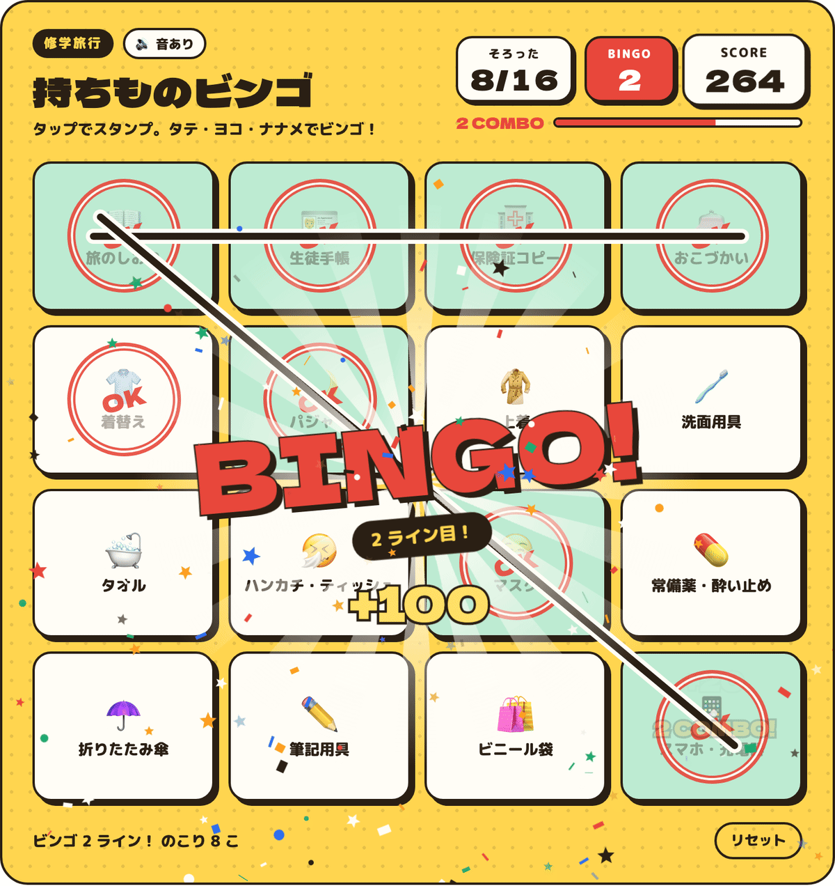
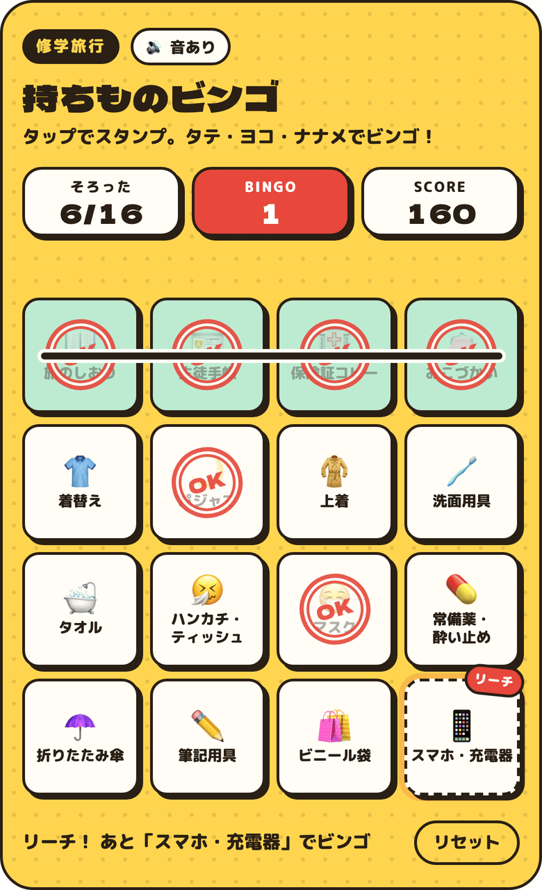
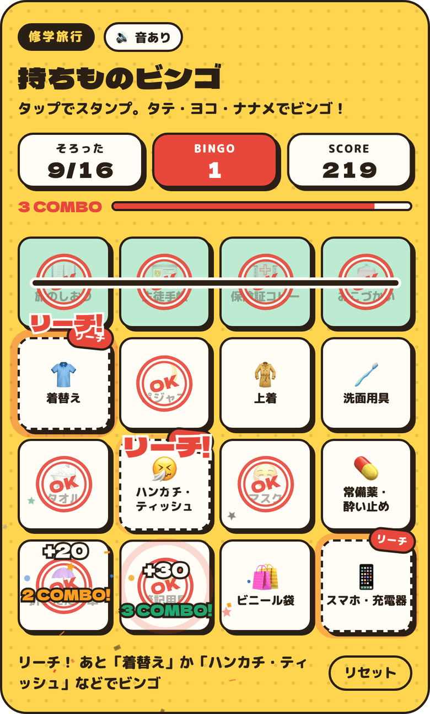
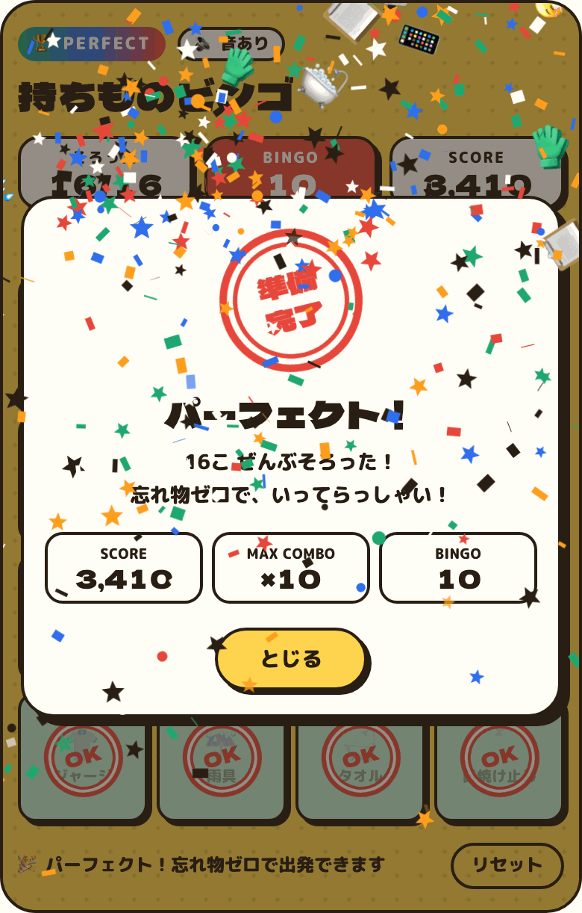

# Packing Bingo (持ちものビンゴ)

**A packing checklist for school trips that plays like bingo: stamp each item as it goes in the bag, line them up, and get combos, fanfares and fireworks. Drop it into a React site as one component, or open the single-file HTML page.**

[](https://www.npmjs.com/package/packing-bingo)
[](LICENSE)
[](#use-it-in-react)
[](src/index.ts)
[](index.html)

[Use it in React](#use-it-in-react) · [Standalone page](#standalone-page) · [Customize](#customize) · [Good to know](#good-to-know) · [日本語](#日本語) · [License](#license)

<p align="center">
  <a href="docs/images/bingo-desktop.png"></a>
</p>

_The second line completes on a two-tap combo: the line is drawn, the BINGO! banner and +100 pop up, and confetti bursts. The default UI is Japanese: 持ちものビンゴ = "Packing Bingo", そろった = "packed", 2ライン目 = "2nd line". An English text set is included._

<p>
  <a href="docs/images/phone-reach.png"></a>
  <a href="docs/images/phone-combo.png"></a>
  <a href="docs/images/phone-perfect.png"></a>
</p>

_On a phone, left to right: one line done and a リーチ ("reach") badge on the square that would finish the next one; a three-tap combo; the Perfect! screen with the final score, fireworks and falling item emoji._

## Features

Packing the night before a school trip is a chore. Packing Bingo turns the checklist into a 4×4 bingo card, so every item packed is a stamp, and every few items there's something to celebrate.

- **Packing becomes a game.** The 16 items sit on a 4×4 card. Any row, column or diagonal is a bingo, for 10 possible lines.
- **There's always a next goal.** A square that would complete a line pulses and gets a リーチ ("reach") badge, and the footer names the item that would finish it.
- **Every tap gives feedback.** Each stamp comes with a ripple and sparks. Taps less than 2.5 s apart chain into a combo, with a rising note on each tap and a draining combo gauge.
- **The score rewards finishing.** An item is worth 10 points × the current combo the first time it's stamped. Completing n lines at once adds 100 × n² points, and the first full card adds a 1000-point bonus. Unchecking and re-checking adds nothing.
- **Finishing gets a real finale.** Stamping all 16 plays a "ready" stamp slam, fireworks and falling item emoji, then counts up the score, max combo and lines.
- **It fits into your site.** It's one React component with TypeScript types. All its CSS is scoped and prefixed, it lays itself out by the width of its own container rather than the screen, it renders safely on the server (Next.js App Router included), and you can theme it with CSS variables.
- **Sound needs no audio files.** All effects are synthesized with the Web Audio API. The 🔊 toggle mutes them, and the choice is remembered in the browser.
- **It's considerate by default.** Squares are real checkboxes, so the keyboard works. `prefers-reduced-motion` turns off particles, shaking and bouncing. Android phones vibrate on taps and bingos.

## Use it in React

You need React 18 or later.

```sh
npm install packing-bingo     # or: pnpm add packing-bingo / yarn add packing-bingo
```

Render the component wherever the checklist should go:

```tsx
import { PackingBingo } from "packing-bingo";

export default function PackingPage() {
  return <PackingBingo storageKey="kyoto-trip-2026" />;
}
```

With `storageKey`, each student's progress is saved in their browser, so they can close the page and come back. The component ships with `"use client"`, so in the Next.js App Router you can use it straight from a page. It renders an empty `<div>` on the server and builds the card in the browser.

### Your own items and English text

```tsx
import { PackingBingo, en, type BingoItem } from "packing-bingo";

const items: BingoItem[] = [
  { emoji: "🛂", label: "Passport" },
  { emoji: "🎫", label: "Tickets" },
  // … exactly 16 items, row by row from the top left
];

<PackingBingo items={items} messages={en} title="Kyoto Trip" tag="Class 2-B" />;
```

`messages` takes any subset of the UI text, so `messages={{ reset: "Start over" }}` changes just that one label. Define `items` and `messages` outside the component, or memoize them, because changing them rebuilds the card.

### Keeping the state yourself

To store progress in your own backend or app state, make it controlled:

```tsx
const [checked, setChecked] = useState<boolean[]>(Array(16).fill(false));

<PackingBingo
  checked={checked}
  onChange={setChecked}
  onBingo={({ newLines, totalLines }) => console.log("bingo!", newLines, totalLines)}
  onPerfect={({ score }) => saveResult(score)}
/>;
```

Only a change of a single item plays like a tap. A bigger jump in `checked`, such as loading saved progress from your server, updates the card quietly, with no fanfare and no bonus points for lines completed all at once.

### Props

| Prop | Type | Default | What it does |
| --- | --- | --- | --- |
| `items` | `BingoItem[]` (16) | Japanese school-trip list | Squares, row by row: `{ emoji, label }` |
| `messages` | `Partial<Messages>` | `ja` | UI text; `en` is included |
| `title`, `tag`, `subtitle` | `string` | from `messages` | Heading, the small tag above it, and the line below it |
| `defaultChecked` | `boolean[]` (16) | all `false` | Initial state when uncontrolled |
| `checked` | `boolean[]` (16) | – | Controlled state; update it in `onChange` |
| `onChange` | `(checked) => void` | – | Called after each tap or reset (before `onBingo`/`onPerfect`) |
| `onBingo` | `({ newLines, totalLines, score }) => void` | – | Called when a tap completes lines |
| `onPerfect` | `({ score, maxCombo }) => void` | – | Called when all 16 are stamped |
| `storageKey` | `string` | – | Save progress in localStorage (uncontrolled only) |
| `sound` | `boolean` | `true` | Start with sound on or off, unless the user has already chosen |
| `fonts` | `boolean` | `true` | Load Dela Gothic One and M PLUS Rounded 1c from Google Fonts |
| `demo` | `boolean` | `false` | Pre-fill six items and show demo buttons |
| `className`, `style` | | – | Applied to the wrapper `<div>` |

A `ref` gives you `reset()`, `setChecked(checked)` and `getState()`. `setChecked` follows the same rule as `checked`: one item changes like a tap, more change quietly. `getState()` returns the checks, completed lines, score, max combo and whether the card is complete.

### Theming

Set any of these CSS variables on the component or an ancestor: `--pkb-sun` (board), `--pkb-ink` (lines and text), `--pkb-paper` (squares), `--pkb-red` (stamps and accents), `--pkb-mint` (completed lines), and `--pkb-font-fallback`.

```tsx
<PackingBingo style={{ "--pkb-sun": "#9AD0F5" } as React.CSSProperties} />
```

The card is at most 720 px wide and switches to its compact layout below 560 px of available width.

### Without React

The engine has no framework dependency:

```ts
import { createPackingBingo } from "packing-bingo/core";

const card = createPackingBingo(document.getElementById("bingo")!, { storageKey: "trip" });
// later: card.destroy();
```

## Standalone page

`index.html` is the whole app in one file, so you can open it directly or put it on any static host. It saves progress in the browser.

```sh
git clone https://github.com/Jin-hiroo/packing-bingo.git
cd packing-bingo
open index.html        # macOS; on other systems, open the file in a browser
```

Add `?demo` to the URL to start part-way through and show the demo buttons: "▶ ビンゴを見る" plays a bingo, and "▶ コンボ → パーフェクト" plays a combo run to a full card. On GitHub Pages, use **Settings → Pages → Deploy from a branch → `main` / root**.

## Customize

- **React:** use the `items`, `messages`, `title`, `tag` and `subtitle` props shown above.
- **Standalone page:** the last `<script>` in `index.html` calls `PackingBingo.createPackingBingo(…)`. Add options there, for example `items: [{ emoji: "🛂", label: "Passport" }, …]`. To change the defaults for every build, edit `src/items.ts` or `src/messages.ts` and run `npm run build`.

The card needs exactly 16 items, and it throws an error otherwise. On narrow screens, labels wrap after a `・`, so `常備薬・酔い止め` breaks as 常備薬・ / 酔い止め.

## Development

```sh
npm install          # also builds dist/ and index.html
npm run build        # dist/ (ESM, CJS, types, browser bundle) and the standalone index.html
npm run typecheck
```

`index.html` is generated from `src/` by `scripts/build-standalone.mjs`, so don't edit it by hand.

## Good to know

- **Saving is per browser.** `storageKey` and the standalone page use localStorage, so progress doesn't follow a student to another device. For that, use controlled mode and store `checked` yourself.
- **Emoji look different on each system**, because they come from the device's emoji font.
- **Vibration works only where the Vibration API exists**, which in practice means Android browsers. iPhones don't vibrate.
- **Testing so far:** the React component was tested with React 19 in StrictMode, three cards on one page, controlled and uncontrolled, and server rendering with `renderToString` (ESM and CommonJS). Resets and callbacks that land mid-celebration were checked with scripted browser tests, which aren't part of this repository yet. Taps were automated in Chromium at desktop and phone sizes. Safari, Firefox and real phones haven't been tried yet, and the sound hasn't been checked on a real device.

## 日本語

修学旅行の持ち物チェックリストを、4×4のビンゴにしたものです。持ち物を入れるたびにマスをタップしてスタンプを押し、タテ・ヨコ・ナナメがそろうとビンゴになります。コンボ・スコア・効果音・花火で、前の晩の荷造りを少し楽しくします。

- **Reactのサイトで使う場合：** `npm install packing-bingo` でインストールし、`<PackingBingo storageKey="kyoto-trip-2026" />` と書くだけで表示できます。持ち物は `items`、画面の文言は `messages` で変更できます。Next.jsのApp Routerでもそのまま使えます。
- **単体のページで使う場合：** `index.html` を開くだけで動き、進み具合はブラウザに保存されます。`?demo` を付けると、途中まで埋まった状態とデモ用のボタンが出ます。

## License

[MIT](LICENSE) © 2026 Jin-hiroo.

The Dela Gothic One and M PLUS Rounded 1c fonts are loaded from Google Fonts and are licensed under the SIL Open Font License. They aren't included in this repository.
